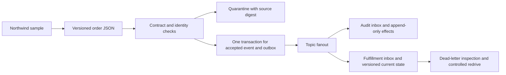

# Order Integration Middleware

Two teams need the same order for different purposes. Fulfillment needs the newest version of each order. Audit needs every accepted version. This project demonstrates how one subscriber can catch up after an outage while the other keeps processing, and how repeated deliveries affect each order exactly once per consumer in the local store.

**Validation.** The local drill processed **1,000 logical submissions** derived from Microsoft's Northwind sample. Audit recorded all 1,000 while fulfillment was unavailable. After restart, quarantine repair and dead-letter redrive, all 830 current orders and 1,000 audit entries matched an independent decimal calculation. **Azure integration, security, cost, performance and recovery remain unvalidated.** [Validation evidence](docs/VALIDATION.md).

## Run the sample

Python 3.12 or later with SQLite suffices for the local middleware. The first command downloads the pinned Microsoft sample SQL file; the adapter parses its selected INSERT literals without executing it.

```bash
python3 order_source.py --data-dir data
python3 validate_workload.py data/submissions.jsonl
python3 -W error::ResourceWarning -m unittest discover -s tests -v
```

The validation command uses a temporary database. To explore the persistent state locally:

```bash
python3 order_middleware.py data/orders.sqlite publish data/submissions.jsonl
python3 order_middleware.py data/orders.sqlite relay
python3 order_middleware.py data/orders.sqlite consume audit
python3 order_middleware.py data/orders.sqlite consume fulfillment
python3 order_middleware.py data/orders.sqlite summary
sqlite3 -header -column data/orders.sqlite < sql/operations.sql
```

For a small experiment without network access, run `python3 order_source.py --fixture --data-dir data/demo` and use `data/demo/submissions.jsonl` in a separate database.

## Source and metrics

The source is a fictional trading company with 830 orders and 2,155 detail lines dated July 1996 through May 1998. Each base order becomes a version-one event. The first 170 orders receive an explicitly synthetic version two that adds one unit to their first item. Event IDs, version fields, deliveries, timing, outages and repairs are synthetic. The public repository contains aggregate evidence and code. [Exact source commit, access date, license and generated workload digest](docs/SOURCE.md).

An event is unique by ID and by order/version. Monetary values are in sample minor units. Each line applies the discount to quantity times unit price and rounds half-up to one minor unit, then the order sums the rounded lines. **Current order value** counts one newest version per order. Adding audit versions together would count an amended order twice. The complete drill's current state totals **126,930,796 minor units**. The audit log retains each event separately for traceability.

## Architecture



| Component | Purpose and validation |
|---|---|
| Python and SQLite WAL | Runnable local model for atomic ingest, durable fanout, independent consumers, version checks and operator repair history. |
| Azure SQL and Container Apps Job | Deployment target for a bounded export through a least-privilege view. The pinned source projection and deterministic JSON were prepared locally. |
| Blob Storage, Event Grid, Functions | Immutable object per event, ETag-conditional payload reads and topic publishing. Storage SDK behavior was exercised against Azurite. |
| Service Bus Standard and two Logic Apps | Independent subscriptions, peek-lock delivery and completion after successful apply. Workflow definitions and resource bindings were checked offline. |
| Table Storage and Application Insights | Conditional, atomic receipt/effect batches plus telemetry target. Table SDK behavior was exercised locally. |
| Bicep, Azure DevOps and GitHub Actions | Gated environment definitions with local template compilation and deterministic CI configuration. |

The cloud target follows Azure SQL → export job → Blob → Event Grid → publisher Function → Service Bus topic → separate Logic Apps → apply Function and Table Storage. The local SQLite relay commits both subscription deliveries and the outbox mark atomically. Cloud boundaries use independent durable operations, stable message IDs, idempotent consumers and reconciliation. Microsoft's delivery guidance describes the loss-of-acknowledgment case behind this design. [Service Bus delivery guarantees](https://learn.microsoft.com/en-us/azure/service-bus-messaging/service-bus-message-loss-and-duplicates).

## Recovery and interview discussion

The [contract guide](docs/CONTRACT.md) documents the event schema, table grain and indexes, invalid-body retention, delivery attempts, quarantine repair and superseding corrections. The [SDK adapter guide](docs/ADAPTERS.md) explains exact cloud-target bindings and the local emulator drill. The [Azure runbook](docs/AZURE.md) covers prospective identities, deployment sequencing, cleanup and cost approval.

- **What happens after a lost acknowledgment?** The retry finds the receipt committed alongside the business effect. The consumer can acknowledge the same event without appending another audit entry or regressing current state.
- **Why keep audit and fulfillment separate?** Their outcomes and retry histories differ. During a fulfillment outage, the auditor can still commit every event on its own subscription.
- **How is a correction distinguished from a retry?** A correction has a newer order version and distinct event ID. A changed body under an existing identity is a conflict requiring investigation.
- **Where does the local model stop?** SQLite tests prove local transaction and restart behavior. Multi-service network failures, managed identity authorization, native cloud dead-letter processing and cloud cost need an approved cloud run.

Original code is MIT licensed. Microsoft retains its [sample-code notice](docs/MICROSOFT-LICENSE.txt).
