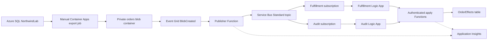

# Azure deployment target

The templates describe a small event-driven order integration lab. On 11 November 2026, Bicep 0.46.1 compiled the entry template, all three nested modules and the development parameters. The offline validator compared the compiled resources and workflow definition with the order transport contract. The workflow JSON also passed Draft 4 validation against Microsoft's published [Workflow Definition Language schema](https://schema.management.azure.com/providers/Microsoft.Logic/schemas/2016-06-01/workflowdefinition.json), SHA-256 `7795118ae8a8dcfe7bdf0b84229be08cde8bc7ebd9eeac9e6c372746c520499d`. The compiled workflow supplies the broker and Function managed-identity authentication objects through service-specific parameters. Azure DevOps YAML parsing and shell syntax checks passed. The local deployment helper refused unset or unapproved inputs before invoking Azure CLI.

Azure provisioning, authentication, broker settlement, Functions execution, Logic Apps delivery, cloud recovery, performance and charges all require a future approved trial.

## Architecture



| Phase | Implemented resources | Operator action after an approved deployment |
|---|---|---|
| `off` | The entry template conditions out all modules. The dev parameter file selects this phase. | Compile and inspect. Changing an existing incremental deployment to off does not remove resources. |
| `foundation` | Standard Service Bus with topic `order-events` and independent `fulfillment` and `audit` subscriptions, private blob container `orders`, Table Storage `OrderEffects`, Entra-only Basic SQL database `NorthwindLab`, exporter/workflow managed identities, workspace-based Application Insights, diagnostics and a broker dead-letter alert. A supplied digest-pinned public image adds a manual Container Apps job. | Populate and inspect the SQL export view. Establish narrow SQL network access and database permissions. |
| `runtime` | Dedicated Functions host storage, Linux Flex Consumption Python 3.12, system-assigned identity, scoped role assignments and mandatory App Service authentication for HTTP consumer routes. | Verify identity permissions and authentication first. Deploy the reviewed Function package, then verify the registered `publish_order` trigger and apply routes. |
| `wired` | A BlobCreated Event Grid subscription targets the published Azure Function. Two independent Consumption Logic Apps receive from their respective Service Bus subscriptions. Both workflows are provisioned **Disabled**. | Run a bounded authorization/settlement test. Enable each workflow only during the approved observation window. |

Run the offline checks from the repository root:

```bash
python3 infra/validate.py
bash -n infra/manage_lab.sh
```

If needed, pass `--bicep /path/to/bicep`. The validator writes temporary ARM files and checks that off is the default, workflow identities are allowlisted, both subscriptions have a retry limit, the stored workflow matches the reviewed definition, and settlement follows a successful apply. The intentionally refused `infra/prod.bicepparam` produces BCP033 for `environment=prod`.

## Contracts and identity

- **Export.** The manual Container Apps job receives `AZURE_CLIENT_ID`, `ORDERS_SQL_SERVER`, `ORDERS_SQL_DATABASE=NorthwindLab`, `ORDERS_STORAGE_ACCOUNT`, `ORDERS_CONTAINER=orders`, `ORDERS_PREFIX=events/` and `ORDERS_EXPORT_ENABLED=false`. The exporter identity has Blob Data Contributor on the order container. An authorized SQL administrator must create its contained database user and grant SELECT only on `dbo.PortfolioOrderLines`. Define that view and check its numeric precision and source digest using the export documentation. The SQL firewall starts without client allowances. Plan a specific development IP/egress route or private networking before the job runs.
- **Publication.** The Event Grid filter admits BlobCreated for `/blobServices/default/containers/orders/blobs/events/` and suffix `.json`. The publisher identity has Blob Data Reader at the order container and Service Bus Data Sender at the topic. Publishing can be repeated after response loss. The stable message ID participates in the topic's ten-minute duplicate detection. Durable consumer receipts cover longer retries. The Event Grid subscription retries up to ten times within 24 hours. A source-archive inventory and replay drill are required to recover notifications that expire. A separate Event Grid dead-letter destination is a possible extension.
- **Function infrastructure.** Host and deployment storage are separate from order data. The Function identity has Blob Data Owner on its dedicated host account. Application data uses the narrower container/table roles. Shared keys and anonymous blobs are disabled. The runtime requires an existing Entra app registration with the approved tenant, client ID and token audience `api://<client-id>`. App Service authentication returns 401 to unauthorized callers and restricts the app to the two workflow identities. The only excluded path is the native Event Grid host webhook, which uses the Functions Event Grid system key. Verify that it rejects requests without that credential. Deploy the package **after** checking Easy Auth. Consumer code must also check the platform-supplied principal ID for the requested subscription route.
- **Independent consumption.** Each workflow identity has Service Bus Data Receiver scoped to its own subscription. A one-minute recurrence with trigger concurrency one polls a single message using the REST peek-lock operation. A 201 response includes a locked-message Location. Empty polls (204) perform no apply or settlement. The flow checks that the Location starts with the expected HTTPS namespace and subscription message path, calls `POST /api/apply/fulfillment` or `POST /api/apply/audit` with its managed identity, and DELETEs that exact URI only after HTTP 200. The handler records receipts and the consumer effect atomically in `OrderEffects`. The caller never ships goods or charges a customer. [Peek-lock API](https://learn.microsoft.com/en-us/rest/api/servicebus/peek-lock-message-non-destructive-read) and [settlement API](https://learn.microsoft.com/en-us/rest/api/servicebus/delete-message).
- **Failure.** A failed handler, identity check, or lost settlement response leaves the delivery unsettled; a two-minute lock may then expire. Persistent failures ultimately enter that subscription's built-in DLQ after the configured five-delivery limit. Existing completion may make a duplicate DELETE fail after an ambiguous network response. Repeated business delivery uses the original event identity. Investigate the raw blob, broker delivery, immutable version and per-consumer receipt before any controlled DLQ repair. The low-volume polling design processes at most one item per minute per consumer and can take longer under retry/lock expiry. Validate baseline behavior with a few cloud messages first. The 1,000-submission acceptance exercise is local.
- **Evidence and monitoring.** Workflow HTTP inputs/outputs and the broker-issued locked URI are protected in run history. Workspace diagnostic settings route broker operational logs and workflow runtime results. Application Insights receives Function runtime/application telemetry. A five-minute maximum dead-letter backlog above zero triggers the Azure Monitor metric alert; supply an approved action group and test actual delivery. Diagnose the stage using source manifest counts, publisher acknowledgments, per-subscription active/DLQ backlog, workflow failures, effect counts, version conflicts and duplicate receipts. Custom freshness alarms and a cross-service dashboard remain future work.

## Approved lab sequence and cleanup

The Azure DevOps pipeline has no automatic trigger and defaults to validation. A manually selected non-validation phase needs a scoped workload-identity service connection, an existing dedicated resource group, approved SQL administrator group name/object ID and an explicit budget approval reference. Runtime/wired also require the approved API app client ID. Set the deployment environment `orders-lab-approved` to require an independent approval in Azure DevOps before using the pipeline. Its preview performs a resource group what-if. Review the diff, identity scopes, deployment order and resulting AUD estimate before the environment approval. Declarative role assignments require appropriately scoped role-assignment permission on the lab resources.

Build and scan the exporter and Functions package before their eventual use. The exporter image parameter accepts a reviewed public image pinned by digest. Private registry pull permissions require separate configuration. Upload the package through supported Flex Consumption deployment tooling. Confirm Easy Auth and the webhook system key, SQL and Storage connectivity, app route authorization, RBAC propagation, table access, and allowed broker send/receive before admitting order traffic. The template does not seed SQL, publish an image or Function package, start the export job or enable the consumers. Repeat wiring with existing workflows only after draining/stopping them; the declarative state sets them back to Disabled.

Use Australia East as the provisional region. Before provisioning, quote actual regional AUD prices, taxes and billing increments for one Standard Service Bus namespace, one Basic 5-DTU database, two Standard LRS storage accounts, a bounded manual Container Apps execution, Flex Consumption Functions, Event Grid, two polling Logic Apps, telemetry ingestion/retention, and any registry, Entra or network prerequisites. Bound the future trial by elapsed hours, submitted order count, poll/action count and retained data volume. Price the specific quantities and obtain budget and cleanup approval. Production parameters are deliberately blocked. A production design also needs tested private routing, separate principals for effects if stronger isolation is required, retention/restore controls, performance sizing and a measured rate of sustained polling.

At the approved cutoff, disable both workflows, stop producer executions and ingest, remove the project Event Grid subscription to prevent new notifications, record pending messages/DLQ and export needed evidence. Confirm retention obligations, review resources in the dedicated group and any managed resources, then delete only the approved lab resources and verify remaining billing. Provisioned Service Bus and SQL continue to incur cost while idle. The workspace 1-GB/day cap and diagnostic signal counts do not cap total Azure spend.

## Provider references

[Logic Apps HTTP and managed identity](https://learn.microsoft.com/en-us/azure/logic-apps/authenticate-with-managed-identity), [Service Bus duplicate detection](https://learn.microsoft.com/en-us/azure/service-bus-messaging/duplicate-detection), [broker lock and settlement behavior](https://learn.microsoft.com/en-us/azure/service-bus-messaging/message-transfers-locks-settlement), [native Functions Event Grid handler](https://learn.microsoft.com/en-us/azure/event-grid/handler-functions), [Flex Consumption provisioning](https://learn.microsoft.com/en-us/azure/azure-functions/flex-consumption-how-to), [App Service authentication](https://learn.microsoft.com/en-us/azure/app-service/overview-authentication-authorization), [integrated identity authorization checks](https://learn.microsoft.com/en-us/azure/app-service/configure-authentication-provider-aad), [Table transactions](https://learn.microsoft.com/en-us/rest/api/storageservices/performing-entity-group-transactions), and [Azure pricing calculator](https://azure.microsoft.com/en-au/pricing/calculator/).
